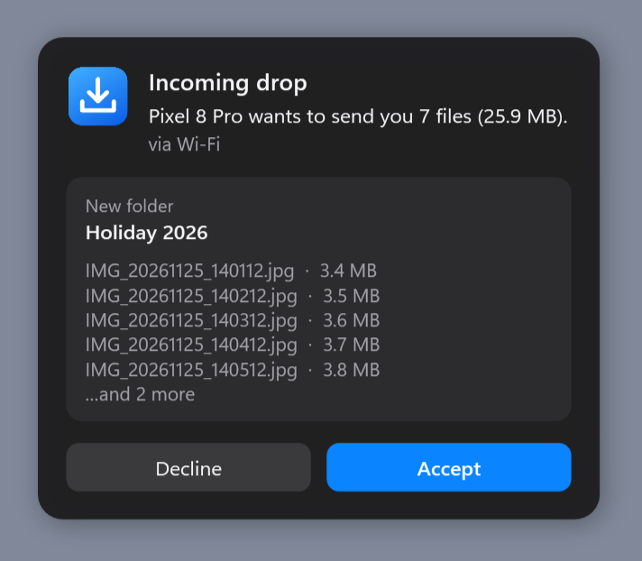
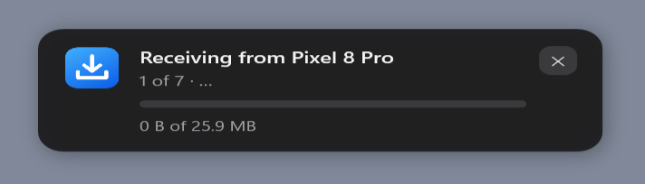
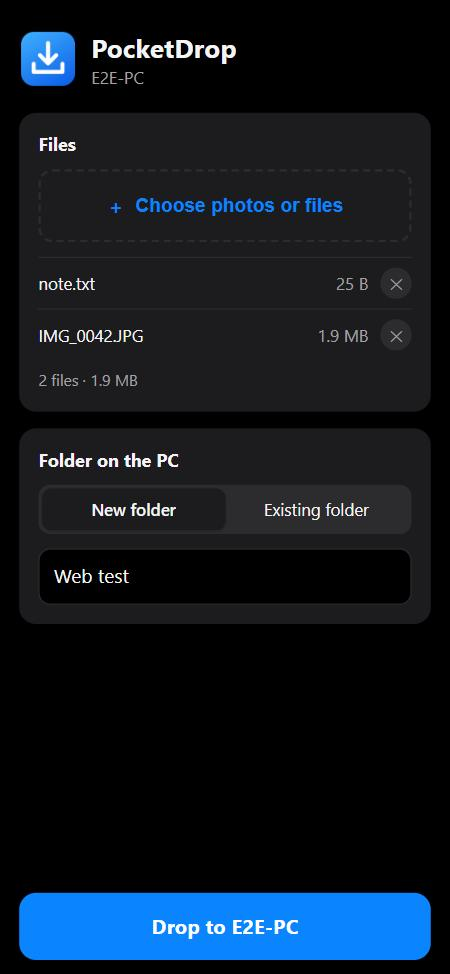

# PocketDrop

**Send photos and files from your phone to your Windows PC — over Wi‑Fi or Bluetooth — in a couple of taps.**

Pick files on the phone, tap **Drop**, accept on the PC, and watch the progress in the top‑right corner of the screen.
When it's done, File Explorer opens the folder with everything you sent.

[Български](README.bg.md)

| Accept on the PC | Progress (top‑right) | Phone (browser sender) |
|---|---|---|
|  |  |  |

## Features

- **Wi‑Fi and Bluetooth.** Wi‑Fi is fast and finds your PC automatically. Bluetooth works without any shared network.
  The installer asks whether your PC has Bluetooth.
- **Confirm on the PC.** Nothing is saved until you press *Accept*.
- **Progress bar in the top‑right corner** with speed and time left; cancel from either side.
- **One folder per drop.** The phone names the folder (or leaves it empty for a date/time name) — or adds to an
  existing folder picked from a list the PC sends.
- **You choose where the folders go** — any drive, any path.
- **Explorer opens automatically** with the received files.
- **Android app** with *Share → PocketDrop* from the gallery or any app.
- **iPhone (and any phone) without an app:** scan the QR code shown on the PC and send from the browser.
- **From anywhere, even on mobile data:** turn on *From anywhere* and scan the second QR code. Works through a free
  Cloudflare tunnel, no account, no router setup.
- English and Bulgarian. Files keep their original dates.
- Safe file handling: names from the phone are sanitised, nothing can be written outside the receive folder.

## Download

Get the latest files from **[Releases](../../releases)**:

| File | For |
|---|---|
| `PocketDrop-Setup-x.y.z.exe` | Windows 10 (1809+) / 11, 64‑bit — installer |
| `PocketDrop-x.y.z-portable.zip` | Windows without installing |
| `PocketDrop-x.y.z.apk` | Android 7.0+ |

## How to use

**On the PC**

1. Run the installer. It asks two things: *does this PC have Bluetooth?* and *where should received files go?*
2. PocketDrop starts in the system tray and starts with Windows. Click the tray icon to open the window
   (PC name, address, QR code for iPhone, Bluetooth, receive folder, options).

**On Android**

1. Install the APK (allow "install unknown apps" for your browser/file manager).
2. Choose **Photos** or **Files** — or share files to *PocketDrop* from any app.
3. Pick your PC under **Send to** (Wi‑Fi: found automatically; Bluetooth: paired devices).
4. Under **Folder on the PC**, type a name for a new folder or pick an existing one.
5. Tap **Drop to <your PC>** and accept on the PC.

**On iPhone / iPad / any phone without the app**

Scan the QR code in the PocketDrop window on the PC (or open the address shown there, e.g. `http://192.168.1.20:45456`),
choose files, pick the folder and tap **Drop**. Tip: *Share → Add to Home Screen* makes it feel like an app.

### From anywhere (mobile data, another network)

1. In PocketDrop on the PC, tick **Allow sending from anywhere over the internet**. The first time, it downloads
   Cloudflare's official `cloudflared.exe` (about 60 MB, checksum verified) into `%LOCALAPPDATA%\PocketDrop\cloudflared`.
2. Scan the QR code that appears (or copy the link and send it to yourself), then send as usual. You still accept
   every drop on the PC.

The link is secret: it contains a random key, and without it nothing can be offered. It changes every time PocketDrop
starts (and when you press **New link**), so scan it again after restarting the PC. Files go through Cloudflare's
servers over HTTPS. Speed depends on the phone's upload speed. The Android app's own sender works only on the same
network; on Android use the link in Chrome.

### Bluetooth

1. Pair the phone with the PC once: Windows *Settings → Bluetooth & devices → Add device*.
2. Turn on *Receive over Bluetooth* in PocketDrop on the PC.
3. In the Android app choose **Bluetooth** and your PC.

Bluetooth is much slower than Wi‑Fi (typically 100–250 KB/s), so it's best for photos and documents.
iPhones can't use it: iOS doesn't let apps use classic Bluetooth to talk to a PC.

### Troubleshooting

- **The phone doesn't find the PC over Wi‑Fi:** both must be on the same network (guest networks often isolate
  devices). Use *Enter PC address* in the app with the address shown on the PC. If your Wi‑Fi is set to "Public" in
  Windows, re‑run the installer with the *public networks* firewall option, or set the network to "Private".
- **Port in use:** another copy is running. Quit it from the tray.
- Logs: `%APPDATA%\PocketDrop\pocketdrop.log`. Settings: `%APPDATA%\PocketDrop\settings.json`.

## Building from source

Requirements: .NET 8 SDK, Inno Setup 6 (installer), JDK 17 and the Android SDK (platform 34).

```powershell
# Everything into .\dist (tests, Windows installer + portable zip, Android APK)
powershell -ExecutionPolicy Bypass -File tools\build-release.ps1 -Version 1.0.0

# Or piece by piece
dotnet test desktop\PocketDrop.Tests
dotnet run --project desktop\PocketDrop.Desktop
cd android; .\gradlew assembleDebug
```

Pushing a tag like `v1.0.0` makes GitHub Actions build everything and attach it to a release
([.github/workflows/build.yml](.github/workflows/build.yml)).

**Android signing:** without a key, release APKs are signed with the debug key — fine for testing, but users can't
update between builds signed with different keys. Create a keystore once and keep it safe:

```powershell
keytool -genkeypair -v -keystore pocketdrop.jks -alias pocketdrop -keyalg RSA -keysize 2048 -validity 10000
```

Locally, put `storeFile`, `storePassword`, `keyAlias`, `keyPassword` in `android/keystore.properties`.
In GitHub, add the secrets `ANDROID_KEYSTORE_BASE64` (the .jks in base64), `ANDROID_KEYSTORE_PASSWORD`,
`ANDROID_KEY_ALIAS`, `ANDROID_KEY_PASSWORD`.

**End‑to‑end test** (Android sender against the real PC receiver):

```powershell
dotnet run --project desktop\PocketDrop.TestReceiver -- $env:TEMP\pd-e2e 300   # in one terminal
$env:POCKETDROP_E2E_FOLDER="$env:TEMP\pd-e2e"; cd android; .\gradlew testDebugUnitTest
```

## Project layout

```
desktop/PocketDrop.Desktop    Windows app (WPF, .NET 8): tray, dialogs, Wi‑Fi/Bluetooth/HTTP receivers
desktop/PocketDrop.Desktop/Web  Browser sender page (served by the PC)
desktop/PocketDrop.Tests      Protocol, HTTP and file-safety tests
desktop/installer             Inno Setup script
android/                      Android app (Kotlin, Jetpack Compose)
docs/PROTOCOL.md              Wire protocol (TCP, Bluetooth RFCOMM, HTTP, UDP discovery)
```

## Security notes

PocketDrop is meant for your own devices on your own network. Anyone on the same network can *offer* files, but
nothing is written until someone at the PC accepts. Traffic is not encrypted over Wi‑Fi (Bluetooth links are
encrypted by the pairing), so avoid sending sensitive files over untrusted Wi‑Fi.

*From anywhere* is off by default. When on, the web server listens on 127.0.0.1:45457 only (reachable through the
tunnel, not from the network), and its API refuses any call without the link's 128‑bit key. Traffic between the phone
and Cloudflare, and between Cloudflare and the PC, is encrypted; Cloudflare terminates TLS, so it can technically see
the files in transit. Use **New link** if you shared the link by mistake.

## Name

"AirDrop" is a trademark of Apple Inc. This project is not affiliated with Apple. The product name lives in one
constant per app (`AppInfo.AppName` on Windows, `app_name` in Android `strings.xml`) if you want to rename it.

## License

[MIT](LICENSE)
